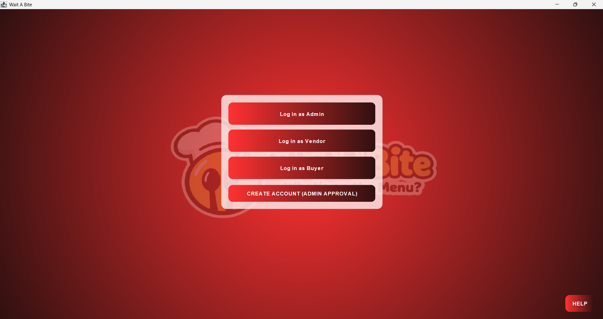
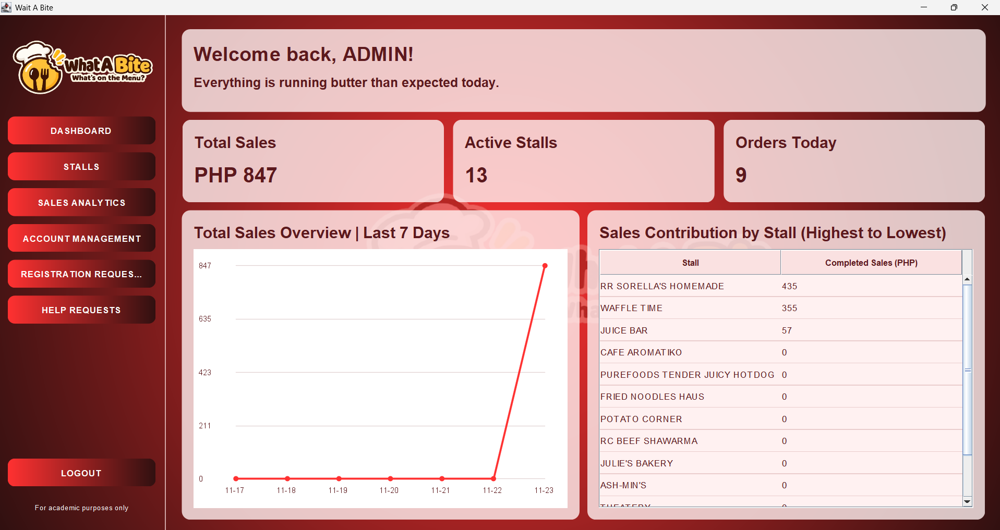
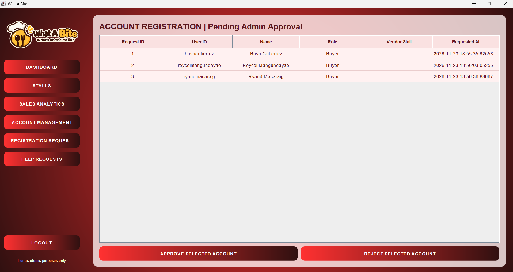
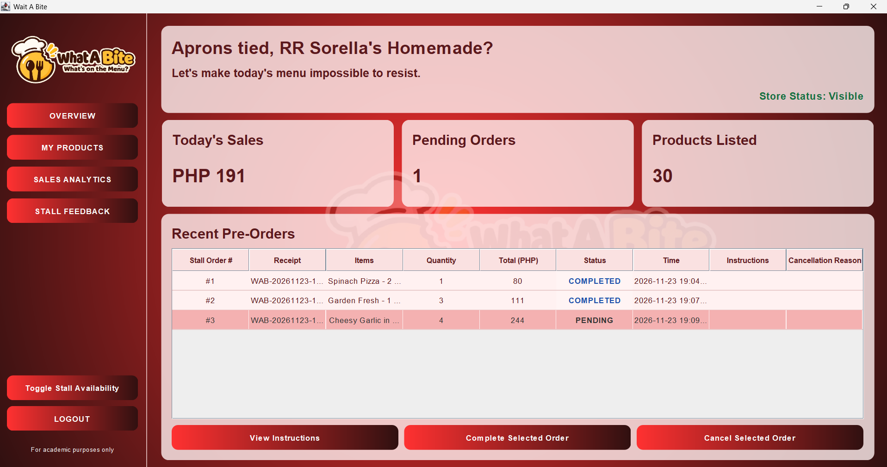
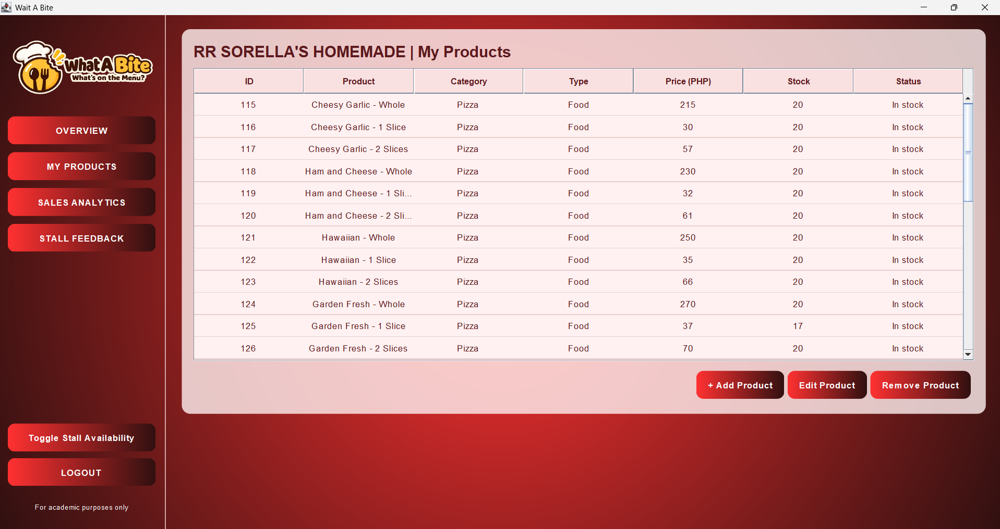
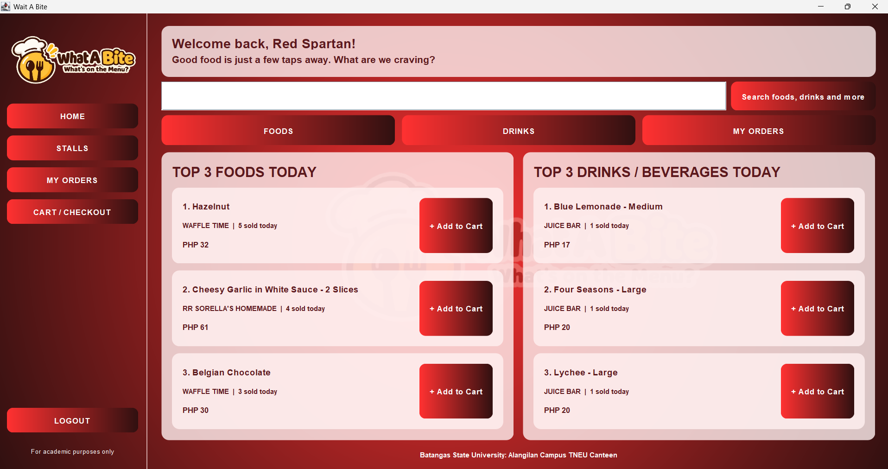
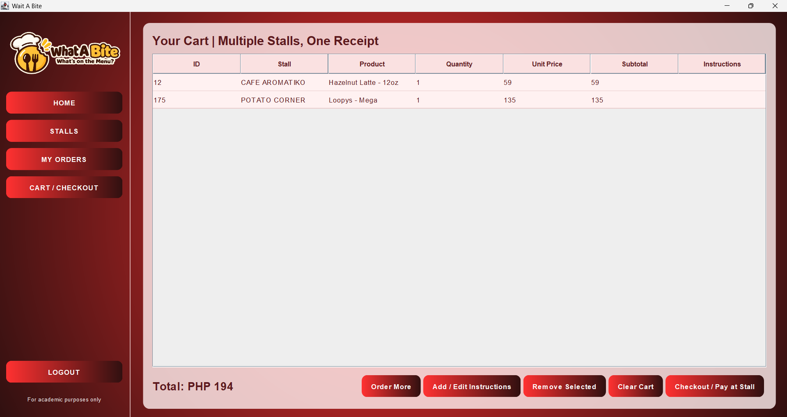
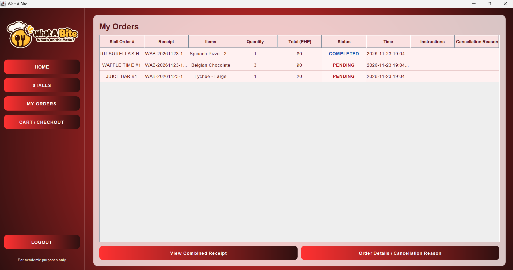

# 🍽️ WAIT A BITE: What's on the Menu?

<p align="center">
  
</p>

<p align="center">
  <em>More than just food—it's about discovering new favorites and satisfying every craving, one bite at a time.</em>
</p>

> **OOP 101 – Object-Oriented Programming** · Information Technology Department
> Batangas State University – The National Engineering University, Alangilan Campus
> College of Informatics and Computing Sciences · 1st Semester, AY 2026–2027
> **Team 11 – Blatte** · Section BSIT-2107

<hr>
<hr>

## 📌 Project Description

<p align="justify">
<strong>Wait A Bite</strong> is a Java-based food purchasing management application designed to track and analyze the purchasing preferences of Red Spartans at Batangas State University – Alangilan Campus. Its main purpose is to help campus vendors understand buyer preferences, identify best-selling products, and monitor product demand through purchase records, product rankings, and sales analytics.
</p>

<p align="justify">
The system supports three user roles: <strong>Admin, Vendor, and Buyer</strong>. Buyers can explore campus stalls, browse products, and place orders, while vendors can manage their products, monitor sales, and identify purchasing trends. Administrators oversee user accounts, stall operations, and overall sales performance.
</p>

<hr>
<hr>

## ⚠️ Problem Being Addressed

<p align="justify">
Campus food stalls offer a variety of food and drinks to Red Spartans. However, without organized purchase records, vendors may find it difficult to identify which products are most purchased, understand buyer preferences, and monitor changes in product demand.
</p>

<p align="justify">
<strong>Wait A Bite</strong> addresses this by tracking and analyzing food and drink purchases made at campus stalls. Through product rankings and sales analytics, the system helps vendors identify best-selling products, understand purchasing trends, and make informed decisions about their food or beverage offerings based on actual purchasing data.
</p>

<hr>
<hr>

## 🎯 Project Objectives
<p align="justify">
The project was designed for Red Spartans at Batangas State University – Alangilan Campus to record, organize, and analyze food and beverage purchases. Its primary objective was to help campus vendors understand buyer preferences, monitor product demand, and make informed decisions based on recorded purchasing data.

Specifically, the project aimed to:

<ul>
  <li><div align="justify"><strong>Record Buyer Purchases</strong> – Record food or beverage purchases made through campus stalls.</div></li>
  <li><div align="justify"><strong>Organize Purchase Records</strong> – Arrange purchasing information according to stalls, products, quantities, and order status.</div></li>
  <li><div align="justify"><strong>Identify Popular Products</strong> – Determine and rank the most and least purchased products based on completed transactions.</div></li>
  <li><div align="justify"><strong>Analyze Purchasing Trends</strong> – Examine purchasing patterns through product sales rankings, stall performance, and sales analytics.</div></li>
  <li><div align="justify"><strong>Generate Sales Reports</strong> – Present sales summaries and product demand information to help vendors understand purchasing preferences and monitor sales performance.</div></li>
</ul>

<hr>
<hr>

## 👥 Target Users

<p align="justify">
The system supports three user roles, each with specific functions:
</p>

<ul>
  <li><strong>Admin</strong> – Manages user accounts, registration requests, stall operations, and overall system data. Monitors sales performance, product rankings, and purchasing trends through sales analytics.</li>

  <li><strong>Vendor</strong> – Manages products, prices, and stock quantities. Processes buyer orders, monitors sales performance, reviews product rankings, and receives stall feedback.</li>

  <li><strong>Buyer</strong> – Explores campus stalls, browses available food or beverages, places orders, tracks purchase history, and submits stall feedback.</li>
</ul>

<hr>
<hr>

## ✨ Main Features

<table>
  <thead>
    <tr>
      <th>Feature</th>
      <th>Description</th>
    </tr>
  </thead>
  <tbody>
    <tr>
      <td><strong>Role-Based Login and Registration</strong></td>
      <td align="justify">Provides separate login access for Admin, Vendor, and Buyer. New buyers and vendors can request accounts, which require administrator approval before activation.</td>
    </tr>
    <tr>
      <td><strong>User and Stall Management (Admin)</strong></td>
      <td align="justify">Allows administrators to manage user accounts, approve registration requests, and oversee campus stall availability.</td>
    </tr>
    <tr>
      <td><strong>Sales Analytics and Product Rankings (Admin)</strong></td>
      <td align="justify">Displays overall sales performance, sales contributions by stall, and product rankings based on completed transactions to identify popular products and purchasing trends.</td>
    </tr>
    <tr>
      <td><strong>Product and Inventory Management (Vendor)</strong></td>
      <td align="justify">Allows vendors to add, edit, and manage products, prices, stock quantities, and stall availability.</td>
    </tr>
    <tr>
      <td><strong>Order Management and Sales Monitoring (Vendor)</strong></td>
      <td align="justify">Enables vendors to process buyer orders, monitor sales performance, and identify their most and least purchased products to better understand buyer demand.</td>
    </tr>
    <tr>
      <td><strong>Campus Stall Browsing and Daily Best Sellers (Buyer)</strong></td>
      <td align="justify">Allows buyers to explore campus stalls, search for available products, and view the top three food and beverage products based on completed purchases for the day.</td>
    </tr>
    <tr>
      <td><strong>Cart, Checkout, and Order Tracking (Buyer)</strong></td>
      <td align="justify">Allows buyers to add products from multiple stalls to their cart, place orders, and track purchase history and order statuses.</td>
    </tr>
  </tbody>
</table>

<hr>
<hr>

## 🛠️ Technologies Used

<p align="justify">
In developing <strong>Wait A Bite</strong>, the team used the following technologies and tools:

- **Java** – Primary programming language used to develop the application.
- **Java Swing and AWT** – Used to create the graphical user interface and sales visualizations.
- **CSV Files** – Used to store and manage system records.
- **Visual Studio Code** – Used for writing, editing, and debugging source code.
- **GitHub** – Used for version control, collaboration, and sharing updated source code among team members.

</p>
<hr>
<hr>

## 🧩 Team Members and Roles

<table>
  <thead>
    <tr>
      <th>Member</th>
      <th>Role / Contributions</th>
    </tr>
  </thead>
  <tbody>
    <tr>
      <td><strong>Gutierrez, Bush A.</strong></td>
      <td align="justify"><strong>UI/Design Lead.</strong> Designed the proposed UI, contributed to project documentation, and helped develop product, vendor, and stall functionalities.</td>
    </tr>
    <tr>
      <td><strong>Macaraig, Ryand Joaquin S.</strong></td>
      <td align="justify"><strong>Lead Programmer.</strong> Led system development, including purchase processing, order management, and CSV file handling.</td>
    </tr>
    <tr>
      <td><strong>Mangundayao, Reycel Ann G.</strong></td>
      <td align="justify"><strong>Project Leader.</strong> Coordinated team tasks and contributed to UI design, project documentation, user authentication, and registration features.</td>
    </tr>
  </tbody>
</table>

---
---
## 🧠 OOP Concepts Demonstrated

<table>
  <thead>
    <tr>
      <th>OOP Concept</th>
      <th>How It Is Used</th>
    </tr>
  </thead>
  <tbody>
    <tr>
      <td><strong>Classes and Objects</strong></td>
      <td align="justify">Represents registered users through Admin, Vendor, and Buyer objects, and products through Food and Drink objects. WaitABiteSystem organizes these objects and creates PurchaseRecord entries whenever a buyer successfully checks out.</td>
    </tr>
    <tr>
      <td><strong>Methods</strong></td>
      <td align="justify">Divides system operations into reusable functions. For example, login() validates user credentials, checkout() processes purchases and deducts stock, and cancelOrder() cancels pending orders and restores inventory.</td>
    </tr>
    <tr>
      <td><strong>Encapsulation</strong></td>
      <td align="justify">Restricts direct modification of private user, product, and purchase attributes. Getter methods retrieve information, while updateInfo(), setActive(), and cancel() control changes to product details, account status, and orders.</td>
    </tr>
    <tr>
      <td><strong>Inheritance</strong></td>
      <td align="justify">Allows Admin, Vendor, and Buyer to reuse account details and login functionality from User. Similarly, Food and Drink inherit product information, pricing, and stock-management functions from MenuItem.</td>
    </tr>
    <tr>
      <td><strong>Polymorphism</strong></td>
      <td align="justify">Allows the system to process different users and products through their parent classes. Calling role() identifies the correct user type, while type() identifies whether a product is Food or Drink.</td>
    </tr>
    <tr>
      <td><strong>Abstraction</strong></td>
      <td align="justify">Uses abstract classes User and MenuItem to define shared functionality while requiring subclasses to implement role() and type(). This separates common behavior from class-specific behavior.</td>
    </tr>
    <tr>
      <td><strong>Interfaces</strong></td>
      <td align="justify">Uses the Authenticatable interface to declare login(String password). The User class implements this method, providing shared authentication behavior for Admin, Vendor, and Buyer accounts.</td>
    </tr>
    <tr>
      <td><strong>Exception Handling</strong></td>
      <td align="justify">Validates transactions and reports errors such as insufficient stock, unavailable products, and invalid registration details using InvalidOrderException. Try-catch blocks handle invalid input and file-processing errors.</td>
    </tr>
    <tr>
     <td><strong>Arrays / Data Handling</strong></td>
     <td align="justify">Uses ArrayList collections to store and organize users, stalls, products, purchases, registration requests, help requests, and feedback. A long[] array stores daily sales totals for the last seven days to support sales analysis.</td>
    </tr>
    <tr>
      <td><strong>File Handling</strong></td>
      <td align="justify">Uses FileHandler.loadData() to restore users, products, and transactions from CSV files when the application starts. saveData() stores updated records so information remains available after closing the program.</td>
    </tr>
  </tbody>
</table>

<hr>
<hr>

## 📂 Project Structure

```
📂Wait-A-Bite/
├── 📂assets/
│   ├── 🖼️Ash-Mins Menu.png
│   ├── 🖼️CafeAromatiko.png
│   ├── 🖼️Chowking.png
│   ├── 🖼️Fried Noodles Haus.png
│   ├── 🖼️Itsnok.png
│   ├── 🖼️JuiceBar.png
│   ├── 🖼️JuliesBakery.png
│   ├── 🖼️PotatoCorner.png
│   ├── 🖼️RC Beef Shawarma.png
│   ├── 🖼️RR Sorellas Homemade.png
│   ├── 🖼️TenderJuicyHotdog.png
│   ├── 🖼️Theatery.png
│   ├── 🖼️Waffle Time.png
│   └── 🖼️wait-a-bite.png
│
├── 📂data/
│   ├── 📄help_requests.csv
│   ├── 📄products.csv
│   ├── 📄purchases.csv
│   ├── 📄registration_requests.csv
│   ├── 📄stall_feedback.csv
│   ├── 📄stalls.csv
│   └── 📄users.csv
│
├── 📂docs/
│   ├── 📄Project-Proposal.pdf
│   └── 🖼️WaitABite-UML-Diagram.png
│
├── 📂gui/
│   ├── ☕ SalesChart.java
│   ├── ☕ Theme.java
│   └── ☕ WaitABiteFrame.java
│
├── 📂screenshots/
│   ├── 🖼️admin-dashboard.png
│   ├── 🖼️buyer-home.png
│   ├── 🖼️buyer-orders.png
│   ├── 🖼️cart-checkout.png
│   ├── 🖼️landing-page.png
│   ├── 🖼️registration-requests.png
│   ├── 🖼️vendor-overview.png
│   └── 🖼️vendor-products.png
│
├── 📂src/
│   ├── ☕ Admin.java
│   ├── ☕ Authenticatable.java
│   ├── ☕ Buyer.java
│   ├── ☕ Drink.java
│   ├── ☕ FileHandler.java
│   ├── ☕ Food.java
│   ├── ☕ HelpRequest.java
│   ├── ☕ InputHelper.java
│   ├── ☕ InvalidOrderException.java
│   ├── ☕ Main.java
│   ├── ☕ MenuItem.java
│   ├── ☕ OrderStatus.java
│   ├── ☕ PurchaseRecord.java
│   ├── ☕ RegistrationRequest.java
│   ├── ☕ Stall.java
│   ├── ☕ StallFeedback.java
│   ├── ☕ User.java
│   ├── ☕ Vendor.java
│   └── ☕ WaitABiteSystem.java
│
├── 📜.gitignore
├── 📜README.md
└── 📜RUN-WAIT-A-BITE.bat
```

<hr>
<hr>

## 🚀 Instructions for Running the Program
### 💻 General Instructions

<div align="justify">Before starting, make sure <strong>JDK 17 or later</strong> is installed and the <strong>Wait A Bite</strong> project is open in Visual Studio Code.</div>

<ol>
  <li><div align="justify">Open the terminal in the project folder and compile the Java files:</div>
    <pre><code>javac -encoding UTF-8 -d out src/*.java gui/*.java</code></pre>
  </li>
  <li><div align="justify">Run the application:</div>
    <pre><code>java -cp out Main</code></pre>
  </li>
  <li><div align="justify">Once the landing page appears, choose from the following options:</div>
    <ul>
      <li><div align="justify"><strong>Admin, Vendor, or Buyer</strong> – Log in to the respective dashboard.</div></li>
      <li><div align="justify"><strong>Create Account</strong> – Register a new Buyer or Vendor account.</div></li>
      <li><div align="justify"><strong>Help</strong> – Submit questions or concerns to the Admin.</div></li>
    </ul>
  </li>
</ol>

*Note: All user roles use the same application and compilation commands.*

---

### 📋 Program Flow

#### 👨‍💼 Admin

<ol>
  <li><div align="justify">Select <strong>Log in as Admin</strong> → Enter credentials → Admin Dashboard.</div></li>
  <li><div align="justify">Open <strong>Dashboard</strong> to monitor total sales, active stalls, daily orders, seven-day sales trends, and stall contributions.</div></li>
  <li><div align="justify">Access <strong>Stalls</strong> to view campus stalls and toggle their availability.</div></li>
  <li><div align="justify">Visit <strong>Sales Analytics</strong> to view product rankings from most to least sold.</div></li>
  <li><div align="justify">Open <strong>Account Management</strong> to add accounts or manage user activation, then check <strong>Registration Requests</strong> to approve or reject new registrations.</div></li>
  <li><div align="justify">Review <strong>Help Requests</strong> to read user concerns and mark them as resolved.</div></li>
  <li><div align="justify">Click <strong>LOGOUT</strong> to return to the landing page.</div></li>
</ol>

---

#### 👩‍🍳 Vendor

<ol>
  <li><div align="justify">Select <strong>Log in as Vendor</strong> → Enter credentials → Vendor Dashboard.</div></li>
  <li><div align="justify">Open <strong>Overview</strong> to monitor today's sales, pending orders, listed products, and recent pre-orders.</div></li>
  <li><div align="justify">Select a pending order to view instructions, mark it as completed, or cancel it with a reason.</div></li>
  <li><div align="justify">Access <strong>My Products</strong> to add, edit, or remove products and manage prices and stock quantities.</div></li>
  <li><div align="justify">Visit <strong>Sales Analytics</strong> to check product rankings and <strong>Stall Feedback</strong> to read Buyer comments.</div></li>
  <li><div align="justify">Use <strong>Toggle Stall Availability</strong> to change the stall's visibility.</div></li>
  <li><div align="justify">Click <strong>LOGOUT</strong> to return to the landing page.</div></li>
</ol>

---
#### 🛒 Buyer

<ol>
  <li><div align="justify">Select <strong>Log in as Buyer</strong> → Enter credentials → Buyer Dashboard.</div></li>
  <li><div align="justify">Open <strong>Home</strong> to search for food and drinks, explore categories, and view the daily top three best sellers.</div></li>
  <li><div align="justify">Visit <strong>Stalls</strong> to browse campus food stalls, select a stall to view its menu, and send feedback if desired.</div></li>
  <li><div align="justify">Select available products, enter quantities, and add items from different stalls to the <strong>Cart</strong>.</div></li>
  <li><div align="justify">Open <strong>Cart / Checkout</strong> to review items, add special instructions, remove products if needed, and confirm checkout.</div></li>
  <li><div align="justify">View the combined receipt and pay at the respective stalls. Visit <strong>My Orders</strong> to track order statuses, view receipts, and check cancellation reasons.</div></li>
  <li><div align="justify">Click <strong>LOGOUT</strong> to return to the landing page.</div></li>
</ol>

---
### 📝 New User Registration

<ol>
  <li><div align="justify">On the landing page, select <strong>CREATE ACCOUNT (ADMIN APPROVAL)</strong>.</div></li>
  <li><div align="justify">Enter the required information and choose <strong>Buyer</strong> or <strong>Vendor</strong>. Vendors must also select their assigned stall.</div></li>
  <li><div align="justify">Click <strong>SUBMIT REQUEST</strong> and wait for Admin approval.</div></li>
  <li><div align="justify">Once approved, return to the landing page and log in using the registered credentials.</div></li>
</ol>

<small><em>Note: New accounts cannot log in until approved by the Admin.</em></small>
---
### 💌 Help and Support

<ol>
  <li><div align="justify">Click <strong>HELP</strong> at the bottom-right corner of the landing page.</div></li>
  <li><div align="justify">Enter your name or User ID, select your account type, and describe your concern.</div></li>
  <li><div align="justify">Submit your concern for the Admin to review and resolve.</div></li>
</ol>

<hr>
<hr>

## 📸 Sample Screenshots

Explore the different interfaces and features of **Wait A Bite**, designed for Admin, Vendors, and Buyers.

### 🍽️ Landing Page

<p align="center">
  
</p>

<p align="center">
  <em>The main interface where users can log in, create an account, or request help.</em>
</p>

### 👨‍💼 Admin

<table>
  <tr>
    <td align="center" width="50%">
      
      <strong>Admin Dashboard</strong>
    </td>
    <td align="center" width="50%">
      
      <strong>Registration Requests</strong>
    </td>
  </tr>
</table>

### 👩‍🍳 Vendors

<table>
  <tr>
    <td align="center" width="50%">
      
      <strong>Vendor Overview</strong>
    </td>
    <td align="center" width="50%">
      
      <strong>Product Management</strong>
    </td>
  </tr>
</table>

### 🛒 Buyers

<table>
  <tr>
    <td align="center" width="50%">
      
      <strong>Buyer Home</strong>
    </td>
    <td align="center" width="50%">
      
      <strong>Cart and Checkout</strong>
    </td>
  </tr>
</table>

<p align="center">
  
</p>
<p align="center">
  <strong>Order History and Tracking</strong>
</p>

<hr>
<hr>

## ⚠️ Known Limitations

<ul>
  <li><div align="justify">Wait A Bite is a Java Swing desktop application without web or mobile access.</div></li>
  <li><div align="justify">Records are stored in local CSV files, limiting real-time synchronization and multi-user access.</div></li>
  <li><div align="justify">Passwords are not encrypted or hashed, and automatic backup and recovery are unavailable.</div></li>
  <li><div align="justify">Online payments and automated notifications for account approvals and order updates are not supported.</div></li>
</ul>

<hr>
<hr>

## 🌱 Future Improvements

<ul>
  <li><div align="justify">Make Wait A Bite accessible across different devices.</div></li>
  <li><div align="justify">Enable secure, real-time data synchronization and multi-user access.</div></li>
  <li><div align="justify">Allow Buyers to register without Admin approval through authorized university record verification.</div></li>
  <li><div align="justify">Add password hashing, account recovery, and automated backups.</div></li>
  <li><div align="justify">Support online payments and automatic account and order updates.</div></li>
</ul>

<hr>
<hr>

## 🤝 Project Contributors

| Name | GitHub |
|---|---|
| Gutierrez, Bush A. | [@boshigui](https://github.com/boshigui) |
| Macaraig, Ryand Joaquin S. | [@kekengm](https://github.com/kekengm) |
| Mangundayao, Reycel Ann G. | [@reycelann](https://github.com/reycelann) |


<hr>
<hr>

## 💐 Acknowledgements

<p align="justify">
<strong>Team BLatte</strong> would like to express its sincere gratitude and appreciation to the following individuals, institution, and tools for their guidance, support, and contributions to the development of <strong>Wait A Bite: What's on the Menu? :</strong>
</p>

<ul>
  <li><div align="justify"><strong>Ms. Fatima Marie P. Agdon, MSCS</strong> – For her guidance, encouragement, and valuable instruction throughout the development of the project.</div></li>
  <li><div align="justify"><strong>Batangas State University – The National Engineering University, Alangilan Campus</strong> – For providing the academic knowledge and learning opportunities that supported the development of the application.</div></li>
  <li><div align="justify"><strong>ChatGPT (OpenAI)</strong> – For assisting Team BLatte in transforming our proposed GUI designs into functional interfaces and providing technical guidance during the development of the application.</div></li>
  <li><div align="justify"><strong>Mermaid AI</strong> – For assisting in generating and visualizing the system's Unified Modeling Language (UML) diagram.</div></li>
  <li><div align="justify"><strong>Future Users</strong> – To the Admin, Vendors, and Buyers who may use Wait A Bite in the future, we appreciate your interest and hope the system provides a more organized and convenient way to manage campus food purchases.</div></li>
</ul>

<hr>
<hr>
