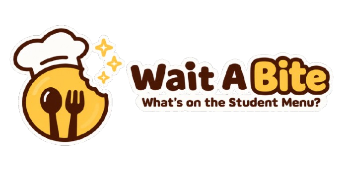

# 🍽️ WAIT A BITE: What's on the Student Menu?

 

*More than just food—it's about discovering student favorites, one bite at a time.*

**Note:** This project is still under development. Its features and documentation, including this README, will be updated as development progresses.

## 📌 Project Description

<strong>Wait A Bite: What's on the Student Menu?</strong> is a food purchasing management system that focuses on student food choices and purchasing activities within campus food stalls. It provides a way to keep track of the food and drinks available and the products purchased by students.

Through its web-based user interface, the system offers different features for administrators, vendors, and buyers according to their respective roles. It also provides an overview of student purchasing preferences, giving a better picture of what's popular on the campus menu.

---
## ⚠️ Problem Being Addressed

Students purchase different kinds of food and drinks from campus stalls every day. However, determining which products are popular among students can be difficult without an organized way of tracking their purchases.

Stall operators often rely on personal observations and judgment to identify which products sell well. Without proper purchase records, it becomes challenging to determine actual product demand and recognize changes in students' buying habits.

<strong>Wait A Bite</strong> aims to address this concern by providing a system that records and analyzes student food purchases. By organizing these records, the system can show which products are purchased most and least often, helping vendors better understand student preferences and product demand.

---
